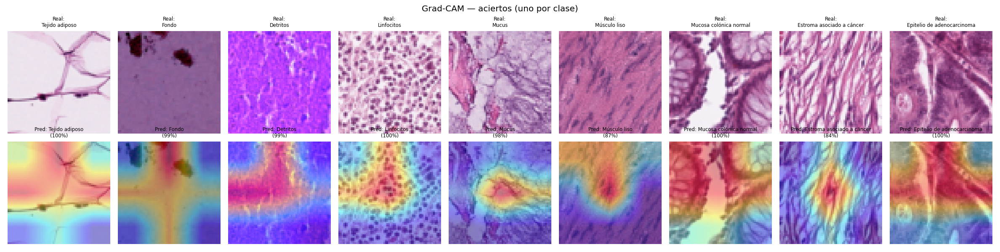
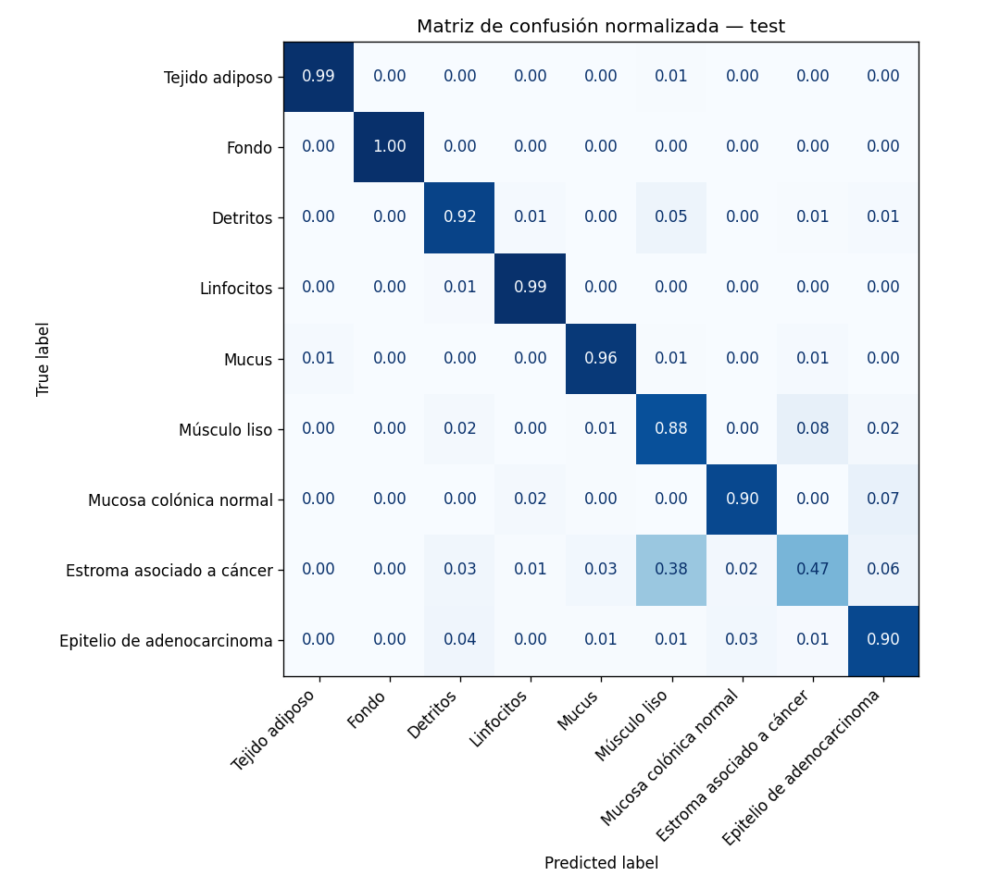
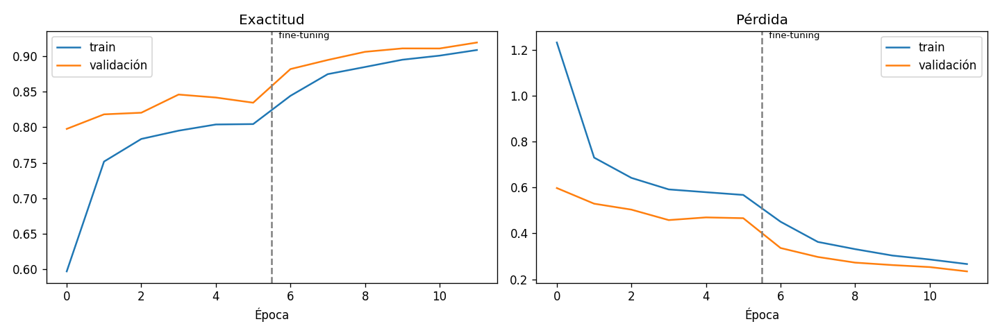
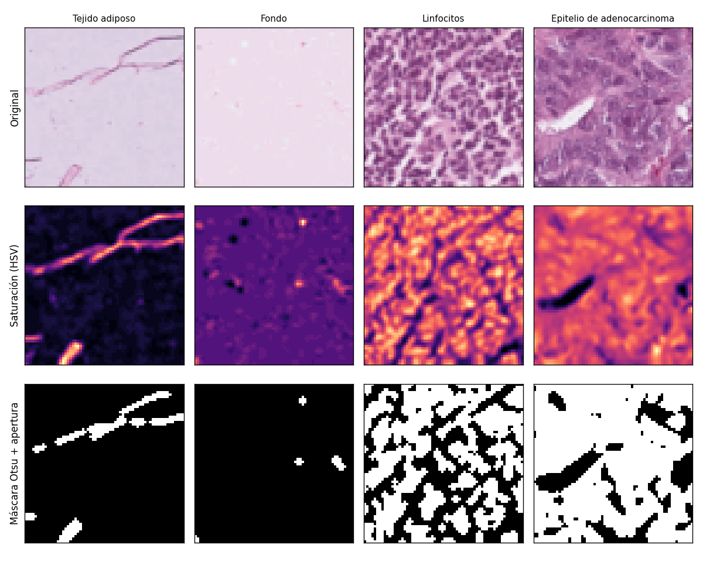

# 🔬 Clasificación de tejido histopatológico con Deep Learning

Clasificación de imágenes de tejido de colon teñidas con H&E en **9 tipos de tejido**, combinando procesamiento digital clásico, transfer learning con **MobileNetV2** e interpretabilidad con **Grad-CAM**.

[](https://colab.research.google.com/github/miriamvelazque/histopatologia-pathmnist/blob/main/clasificacion_tejido_pathmnist.ipynb)

## Resultados

| Métrica | Valor |
|---|---|
| Exactitud en validación (mismo centro) | **91,9 %** |
| Exactitud en test (otro centro clínico) | **91,8 %** |
| F1 macro en test | **0,883** |

Se entrenó con 30.000 imágenes (submuestra estratificada de 89.996), con MobileNetV2 a 96 px, 6 épocas con la base congelada y 6 de fine-tuning.

**Hallazgos principales**
- **Generaliza entre centros:** el test proviene de otro hospital, con otra tinción y otro escáner, y la exactitud prácticamente no cae (91,9 % → 91,8 %). El aumento de datos de color contribuyó a absorber la variación de tinción medida en el análisis exploratorio.
- **6 de 9 clases tienen F1 ≥ 0,91:** fondo (0,99), tejido adiposo (0,99), linfocitos (0,97), mucus (0,97), mucosa normal (0,91) y epitelio de adenocarcinoma (0,91).
- **El punto débil es el estroma asociado a cáncer** (F1 0,57, recall 0,47): el **38 %** se clasifica como músculo liso. Son dos tejidos fibrosos con núcleos alargados que a 64 px resultan morfológicamente muy parecidos. Es un error sistemático, no aleatorio.
- **Grad-CAM** muestra que las decisiones se apoyan en estructuras histológicas (membranas en tejido adiposo, núcleos en linfocitos, glándulas en mucosa y epitelio). La confianza más baja aparece justamente en estroma y músculo liso.

| Grad-CAM: zonas que usa el modelo para decidir | Matriz de confusión (test) |
|---|---|
|  |  |



## Qué incluye

1. **Análisis exploratorio:** distribución de clases, ejemplos por clase y comparación del color medio entre centros (variación de tinción H&E).
2. **Procesamiento clásico (estilo ImageJ):** segmentación de tejido con canal de saturación HSV, umbral de Otsu y apertura morfológica, y cálculo del % de área con tejido por clase. Este análisis reveló que la clase *Fondo* es bimodal: incluye zonas claras y zonas desenfocadas o saturadas. Por eso un umbral de color fijo no alcanza como control de calidad.
   
3. **Modelo:** MobileNetV2 preentrenada en ImageNet. Primero se entrena solo el clasificador con la base congelada y después se hace fine-tuning de las últimas capas, con BatchNorm congelada. El aumento de datos usa rotaciones, espejados y variaciones de brillo, contraste y saturación para simular diferencias de tinción.
4. **Validación:** reporte por clase (precisión, recall, F1) y matriz de confusión normalizada.
5. **Interpretabilidad:** Grad-CAM sobre la última capa convolucional, aplicado a aciertos y errores.
6. **Demo web** en Streamlit (`app.py`): subís un parche de tejido y devuelve la predicción con su mapa de calor.

## Datos

[PathMNIST](https://medmnist.com/) (MedMNIST v2), versión de 64×64 px, derivado de NCT-CRC-HE-100K y CRC-VAL-HE-7K (Kather et al., 2019). Licencia CC BY 4.0. El notebook lo descarga solo.

Clases: tejido adiposo, fondo, detritos, linfocitos, mucus, músculo liso, mucosa colónica normal, estroma asociado a cáncer y epitelio de adenocarcinoma.

## Cómo ejecutarlo

**En Google Colab (recomendado):** abrí el notebook con el botón de arriba, activá la GPU (*Entorno de ejecución → Cambiar tipo de entorno → T4 GPU*) y ejecutá todo. Tarda unos 10–15 minutos.

**Demo local:**
```bash
pip install -r requirements.txt
streamlit run app.py
```
Necesita `modelo_pathmnist.keras` en la misma carpeta. Este archivo se genera al correr el notebook. Para probar la demo podés usar las imágenes de `resultados/ejemplos/`.

## Tecnologías

Python · TensorFlow/Keras · OpenCV · scikit-learn · NumPy · Matplotlib · Streamlit · MedMNIST

## Próximos pasos

- **Separar estroma de músculo liso:** usar mayor resolución (PathMNIST a 128/224 px, que además da mapas Grad-CAM más finos), pesos por clase o *focal loss*.
- Más épocas de fine-tuning: las curvas seguían mejorando al terminar.
- Normalización de tinción (Macenko / Reinhard) y aumento de color en espacio HED.
- Usar la confianza del modelo como filtro: las predicciones con baja probabilidad pasan a revisión de un especialista.
- Comparar con otras arquitecturas (EfficientNet, ResNet).

## Autora

**Miriam Alicia Velazque**, Técnica Superior en Ciencia de Datos e Inteligencia Artificial (CPMA, Río Grande, Tierra del Fuego).
[LinkedIn](https://www.linkedin.com/in/miriam-alicia-velazque)

> ⚠️ Proyecto educativo y de portfolio. No es una herramienta de diagnóstico médico.

### Referencias
- Yang, J. et al. (2023). *MedMNIST v2 — A large-scale lightweight benchmark for 2D and 3D biomedical image classification.* Scientific Data.
- Kather, J. N. et al. (2019). *Predicting survival from colorectal cancer histology slides using deep learning.* PLOS Medicine.
- Selvaraju, R. R. et al. (2017). *Grad-CAM: Visual explanations from deep networks via gradient-based localization.* ICCV.
